# LAPORAN PRAKTIKUM 5

## **PostgreSQL, pgAdmin, Volume, Backup, dan Restore**

**Disusun untuk Memenuhi Matakuliah Workshop DevOps / DevSecOps**  
**Dosen Pengampu:** Dr. Ferry Astika Saputra, ST, M.Sc  


**Oleh:**  
- **Nama:** Rahadyan Danang S.P  
- **NRP:** 3126640054  
- **Kelas:** 1 STr Terapan LJ Teknik Informatika (IT Kelas B)  

**Politeknik Elektronika Negeri Surabaya**  
**Departemen Teknik Informatika dan Komputer**  
**Program Studi Sarjana Terapan Teknik Informatika**  
**Oktober 2026**

---

## 1. TUJUAN PRAKTIKUM

Praktikum Bab 5 bertujuan untuk memahami dan mempraktikkan orkestrasi database relational berbasis Docker Compose, otomatisasi inisialisasi skema dan data, manajemen akses antarmuka (GUI dan CLI), pembuktian persistensi data dengan *named volume*, prosedur *logical backup* dengan verifikasi *checksum*, serta pengujian *restore* pada database terpisah.

Setelah menyelesaikan praktikum ini, mahasiswa diharapkan mampu:
1. Menyusun direktori kerja dan konfigurasi environment terisolasi (`.env.example` dan `.gitignore`) untuk mencegah kebocoran kredensial dan file dump ke version control.
2. Mengonfigurasi `compose.yaml` dengan dependensi *healthcheck* (`pg_isready`), pembatasan network internal, dan persistent volume untuk PostgreSQL 16 serta pgAdmin 4.
3. Mengotomatisasi inisialisasi tabel dan *seed data* awal mahasiswa melalui skrip `init/01-schema.sql` pada direktori `/docker-entrypoint-initdb.d`.
4. Mendaftarkan koneksi database ke pgAdmin secara otomatis melalui konfigurasi `pgadmin/servers.json`.
5. Membuktikan persistensi data volume ketika container dimatikan (`down`) dan dijalankan kembali (`up`).
6. Membuat skrip otomatisasi backup (`scripts/backup.sh`) berformat *custom* beserta generasi *checksum* SHA-256.
7. Menguji keandalan pemulihan data (`scripts/restore-test.sh`) ke database terpisah (`labdb_restore_test`) tanpa merusak database utama.

---

## 2. DASAR TEORI SINGKAT

### A. Karakteristik Stateful Service vs Stateless Service
Container database merupakan service *stateful*, di mana siklus hidup data harus dipisahkan dari siklus hidup container (*ephemeral layer*). Penyimpanan data PostgreSQL membutuhkan *named volume* yang dikelola Docker engine agar data tetap aman saat container dibuat ulang, dihentikan, atau di-*upgrade*.

### B. Mekanisme Inisialisasi Database (`docker-entrypoint-initdb.d`)
Image resmi PostgreSQL mengeksekusi skrip `.sql` dan `.sh` di direktori `/docker-entrypoint-initdb.d` **hanya satu kali** ketika volume direktori data (`PGDATA`) masih kosong. Jika data sudah ada di dalam volume, skrip inisialisasi diabaikan.

### C. Integritas Data dan Relational Schema
PostgreSQL mengimplementasikan model ACID (*Atomicity, Consistency, Isolation, Durability*). Penerapan *constraint* seperti `BIGSERIAL PRIMARY KEY`, `UNIQUE`, `NOT NULL`, dan *indexing* (`CREATE INDEX`) menjamin konsistensi dan integritas data terhadap kesalahan logika aplikasi maupun beban transaksi konkuren.

### D. Keamanan Kredensial dan Secret Management
Penggunaan file `.env` memfasilitasi interpolasi variabel pada Docker Compose. Namun, file `.env` dan hasil backup database (`*.dump`) harus didaftarkan pada `.gitignore` serta diatur permission-nya (`chmod 600 .env`) agar kredensial dan aset sensitif tidak bocor ke publik/repository.

### E. Prinsip Validitas Backup dan Restore
Sebuah backup baru terbukti valid jika: (1) file dump berukuran lebih dari 0 byte, (2) integritas file terbukti via *checksum* SHA-256, dan (3) berhasil diuji pulihkan (*restore test*) serta diverifikasi konsistensi jumlah baris datanya (*row count verification*).

---

## 3. ALAT DAN LINGKUNGAN

- **Sistem Operasi Host:** Linux / Windows 11 (WSL2 / Docker Desktop)
- **Container Platform:** Docker Engine & Docker Compose v2
- **Image Database:** `postgres:16-alpine`
- **Image Dashboard:** `dpage/pgadmin4:latest`
- **Utility Pengujian:** `psql`, `pg_dump`, `pg_restore`, `sha256sum`, `curl`, `bash`

---

## 4. STRUKTUR DIREKTORI PRAKTIKUM

Struktur direktori kerja praktikum:

```text
bab-5/
├── .env.example
├── .env
├── .gitignore
├── compose.yaml
├── init/
│   └── 01-schema.sql
├── pgadmin/
│   └── servers.json
├── scripts/
│   ├── backup.sh
│   └── restore-test.sh
└── backup/
```

**Daftar Berkas dan Fungsinya:**
| No | Nama Berkas | Lokasi | Fungsi |
|:---:|---|---|---|
| 1 | `.env.example` | `bab-5/.env.example` | Template variabel lingkungan laboratorium |
| 2 | `.gitignore` | `bab-5/.gitignore` | Mencegah file kredensial (`.env`) dan berkas dump masuk repository |
| 3 | `compose.yaml` | `bab-5/compose.yaml` | Definisi service PostgreSQL, pgAdmin, volume, network, dan healthcheck |
| 4 | `init/01-schema.sql` | `bab-5/init/01-schema.sql` | Skrip DDL/DML untuk membuat tabel `students` dan data awal |
| 5 | `pgadmin/servers.json` | `bab-5/pgadmin/servers.json` | Konfigurasi *auto-discovery* koneksi server PostgreSQL pada pgAdmin |
| 6 | `scripts/backup.sh` | `bab-5/scripts/backup.sh` | Skrip otomatisasi logical dump dan pembuatan berkas `.sha256` |
| 7 | `scripts/restore-test.sh` | `bab-5/scripts/restore-test.sh` | Skrip validasi restore ke database isolasi `labdb_restore_test` |

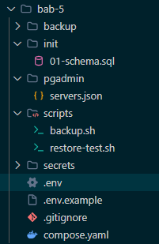
*Gambar 1: Rencana struktur berkas praktikum bab-5*

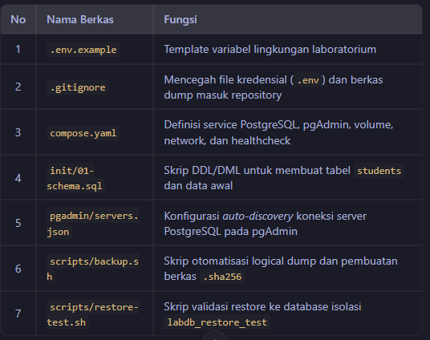
*Gambar 2: Pohon direktori bab-5 yang terbentuk pada terminal*

---

## 5. LANGKAH-LANGKAH IMPLEMENTASI DAN ANALISIS

### A. Menyiapkan Direktori Kerja dan Variabel Lingkungan

1. **Membuat struktur direktori:**
   ```bash
   mkdir -p ~/docker-lab/bab-5/{init,backup,pgadmin,scripts}
   cd ~/docker-lab/bab-5
   ```

2. **Membuat berkas `.env.example`:**
   ```dotenv
   POSTGRES_DB=labdb
   POSTGRES_USER=labuser
   POSTGRES_PASSWORD=labpass123
   PGADMIN_DEFAULT_EMAIL=admin@example.local
   PGADMIN_DEFAULT_PASSWORD=admin123
   ```

3. **Menyalin template ke konfigurasi aktif `.env` dan mengamankan permission:**
   ```bash
   cp .env.example .env
   chmod 600 .env
   ```

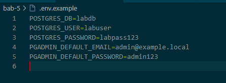
*Gambar 3: Pembuatan berkas .env.example dan penyalinan ke .env aktif*

4. **Membuat berkas `.gitignore`:**
   ```gitignore
   .env
   backup/*.dump
   backup/*.sha256
   backup/*.log
   ```

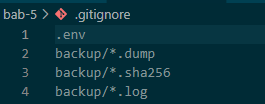
*Gambar 4: Berkas .gitignore untuk memblokir kredensial dan dump file dari Git*

#### **Penjelasan dan Analisis:**
- **Tujuan:** Membuat ruang kerja yang terisolasi dan tertata rapi untuk seluruh artefak proyek Bab 5, serta memisahkan variabel konfigurasi dari kode utama.
- **Analisis Keamanan:** Berkas `.env.example` berfungsi sebagai panduan variabel tanpa membuka kata sandi sensitif. Menyalinnya menjadi `.env` dan membatasi permission (`chmod 600`) memastikan hanya akun pemilik yang dapat membaca kredensial tersebut. Pendaftaran `.env` dan folder `backup/` pada `.gitignore` mencegah secara tak sengaja terdorongnya (*push*) rahasia dan data dump ke repository Git publik.

---

### B. Membuat Skrip Inisialisasi Database (`init/01-schema.sql`)

Skrip SQL berikut dieksekusi secara otomatis saat container pertama kali dijalankan dengan volume kosong:

```sql
CREATE TABLE IF NOT EXISTS students (
    id BIGSERIAL PRIMARY KEY,
    nrp VARCHAR(20) UNIQUE NOT NULL,
    name TEXT NOT NULL,
    created_at TIMESTAMPTZ NOT NULL DEFAULT CURRENT_TIMESTAMP
);

INSERT INTO students (nrp, name)
VALUES
    ('31230001', 'Mahasiswa Satu'),
    ('31230002', 'Mahasiswa Dua')
ON CONFLICT (nrp) DO NOTHING;

CREATE INDEX IF NOT EXISTS idx_students_name
    ON students (name);
```

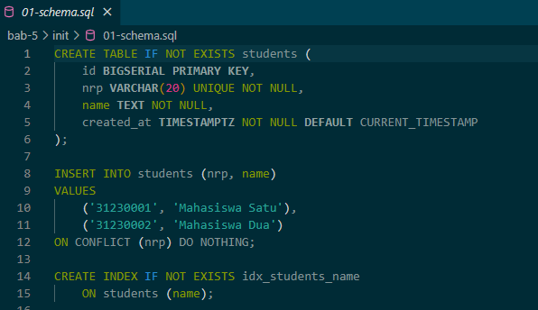
*Gambar 5: Berkas init/01-schema.sql untuk pembuatan tabel students dan seed data*

#### **Penjelasan dan Analisis:**
- **Tujuan:** Membangun struktur skema tabel awal dan memasukkan data sampel (*seed data*) secara otomatis tanpa intervensi manual.
- **Analisis Struktur SQL:** 
  - `BIGSERIAL PRIMARY KEY` digunakan sebagai identifier unik berukuran 64-bit yang otomatis bertambah.
  - Batasan `UNIQUE NOT NULL` pada kolom `nrp` menjamin integritas data mahasiswa agar tidak terjadi duplikasi.
  - Perintah `INSERT ... ON CONFLICT (nrp) DO NOTHING` bersifat *idempotent*, sehingga jika skrip dijalankan ulang tidak akan menimbulkan galat akibat duplikasi baris.
  - Perintah `CREATE INDEX` mempercepat performa kueri pencarian berdasarkan nama mahasiswa. Skrip ini diletakkan pada direktori `./init` yang nantinya dipetakan ke `/docker-entrypoint-initdb.d`.

---

### C. Konfigurasi Server pgAdmin (`pgadmin/servers.json`)

Mendaftarkan koneksi database ke antarmuka pgAdmin 4 secara otomatis tanpa konfigurasi manual:

```json
{
  "Servers": {
    "1": {
      "Name": "PostgreSQL Bab 5",
      "Group": "Laboratorium DevSecOps",
      "Host": "postgres-db",
      "Port": 5432,
      "MaintenanceDB": "labdb",
      "Username": "labuser",
      "SSLMode": "prefer"
    }
  }
}
```

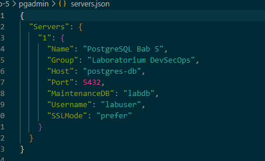
*Gambar 6: Berkas pgadmin/servers.json untuk pendaftaran otomatis server PostgreSQL*

#### **Penjelasan dan Analisis:**
- **Tujuan:** Otomatisasi pendaftaran koneksi server PostgreSQL pada Dashboard GUI pgAdmin 4 ketika container pertama kali diaktifkan.
- **Analisis Jaringan (Hostname):** Parameter `"Host": "postgres-db"` menunjuk ke **nama service** database pada file Docker Compose. Penggunaan nama service ini dimungkinkan karena Docker menyediakan *Embedded DNS Server* antar-container pada satu jaringan (*bridge network*). Penggunaan `localhost` tidak dapat dilakukan di sini karena di dalam container pgAdmin, `localhost` mengacu pada container pgAdmin itu sendiri, bukan container database.

---

### D. Penulisan File `compose.yaml`

Menggabungkan konfigurasi database PostgreSQL, dashboard pgAdmin, network isolasi, named volume, dan healthcheck:

```yaml
services:
  postgres-db:
    image: postgres:16-alpine
    environment:
      POSTGRES_DB: ${POSTGRES_DB}
      POSTGRES_USER: ${POSTGRES_USER}
      POSTGRES_PASSWORD: ${POSTGRES_PASSWORD}
    ports:
      - "127.0.0.1:5432:5432"
    volumes:
      - pg-data:/var/lib/postgresql/data
      - ./init:/docker-entrypoint-initdb.d:ro
    networks:
      - data-net
    healthcheck:
      test:
        - CMD-SHELL
        - "pg_isready -U $${POSTGRES_USER} -d $${POSTGRES_DB}"
      interval: 5s
      timeout: 5s
      retries: 10
      start_period: 10s
    restart: unless-stopped

  pgadmin:
    image: dpage/pgadmin4:latest
    environment:
      PGADMIN_DEFAULT_EMAIL: ${PGADMIN_DEFAULT_EMAIL}
      PGADMIN_DEFAULT_PASSWORD: ${PGADMIN_DEFAULT_PASSWORD}
    ports:
      - "127.0.0.1:5050:80"
    volumes:
      - pgadmin-data:/var/lib/pgadmin
      - ./pgadmin/servers.json:/pgadmin4/servers.json:ro
    networks:
      - data-net
    depends_on:
      postgres-db:
        condition: service_healthy
    restart: unless-stopped

volumes:
  pg-data:
  pgadmin-data:

networks:
  data-net:
    driver: bridge
```

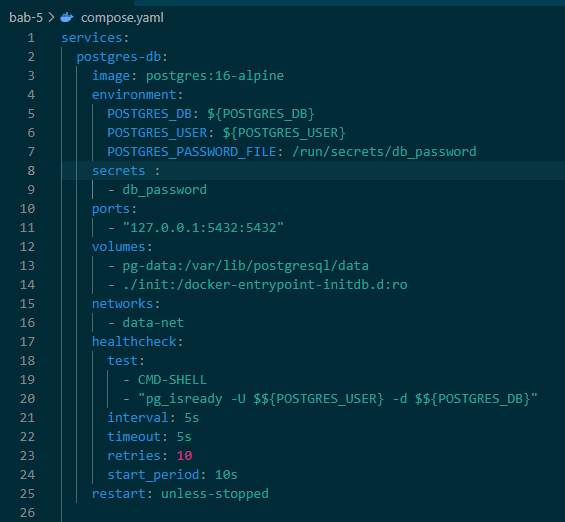
*Gambar 7: Konfigurasi compose.yaml (Service postgres-db)*

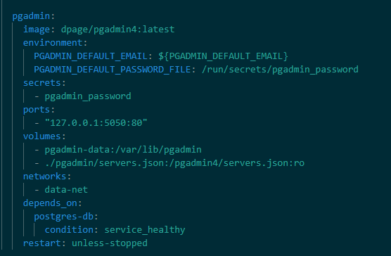
*Gambar 8: Konfigurasi compose.yaml (Service pgadmin dan depends_on)*

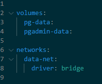
*Gambar 9: Konfigurasi compose.yaml (Deklarasi volumes dan networks)*

#### **Penjelasan dan Analisis:**
- **Tujuan:** Mendefinisikan arsitektur multi-container secara deklaratif mencakup pengikatan port, volume persisten, isolasi jaringan, serta dependensi antarterlibat.
- **Analisis Konfigurasi Utama:**
  - **Environment Variables:** Diinterpolasi dari berkas `.env` sehingga kredensial tidak tertulis secara keras (*hardcoded*).
  - **Port Forwarding:** `127.0.0.1:5432:5432` dan `127.0.0.1:5050:80` membatasi akses port hanya dari antarmuka *loopback* lokal host untuk mencegah paparan jaringan luar yang tidak aman.
  - **Volumes & Mounts:** `pg-data` dipasang ke `/var/lib/postgresql/data` untuk menyimpan data fisik secara persisten. Mount `./init` dipasang secara *read-only* (`:ro`) ke `/docker-entrypoint-initdb.d`.
  - **Healthcheck & Depends_on:** Uji kesehatan `pg_isready` mengecek kesiapan database setiap 5 detik. pgAdmin diberi instruksi `depends_on: postgres-db: condition: service_healthy` agar pgAdmin baru mulai dinyalakan **setelah** PostgreSQL benar-benar siap melayani koneksi, mencegah *race condition*.

---

### E. Pembuatan Skrip Backup (`scripts/backup.sh`)

Skrip untuk melakukan logical backup terotomatisasi dengan `pg_dump` dan menghasilkan berkas checksum SHA-256:

```bash
#!/usr/bin/env bash
set -Eeuo pipefail

cd "$(dirname "$0")/.."

if [[ ! -f .env ]]; then
    echo "[FAIL] File .env tidak ditemukan." >&2
    exit 1
fi

set -a
source .env
set +a

mkdir -p backup

timestamp="$(date -u +%Y%m%dT%H%M%SZ)"
dump_file="backup/${POSTGRES_DB}-${timestamp}.dump"
checksum_file="${dump_file}.sha256"

docker compose exec -T postgres-db \
    pg_dump \
    --username "$POSTGRES_USER" \
    --dbname "$POSTGRES_DB" \
    --format custom \
    --no-owner \
    --no-privileges \
    > "$dump_file"

test -s "$dump_file"
sha256sum "$dump_file" > "$checksum_file"

echo "[PASS] Backup: $dump_file"
echo "[PASS] Checksum: $checksum_file"
```

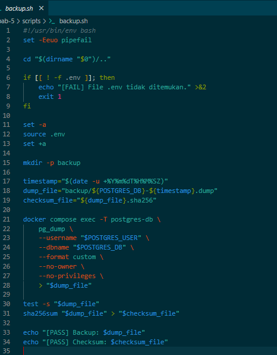
*Gambar 10: Berkas scripts/backup.sh untuk backup biner dan checksum SHA-256*

#### **Penjelasan dan Analisis:**
- **Tujuan:** Menyediakan mekanisme otomatisasi *logical backup* database PostgreSQL berbasis waktu (*timestamp*) dan memverifikasi integritas berkasnya.
- **Analisis Skrip:**
  - `set -Eeuo pipefail` mengaktifkan penanganan kesalahan secara ketat (*strict mode*), sehingga skrip langsung berhenti jika terdapat perintah yang gagal.
  - Perintah `pg_dump` dijalankan melalui `docker compose exec -T` menggunakan format biner *custom* (`--format custom`). Opsi `--no-owner` dan `--no-privileges` disertakan agar berkas backup bersifat portabel saat dipulihkan pada lingkungan/role lain.
  - Perintah `test -s` memastikan berkas dump yang dihasilkan tidak bernilai 0 byte (tidak kosong).
  - Perintah `sha256sum` menghasilkan sidik jari kriptografi SHA-256 yang disimpan pada berkas `.sha256` untuk pembuktian integritas data dari potensi kerusakan berkas.

---

### F. Pembuatan Skrip Uji Restore (`scripts/restore-test.sh`)

Skrip untuk menguji keabsahan file backup dengan melakukan restore ke database uji (`labdb_restore_test`):

```bash
#!/usr/bin/env bash
set -Eeuo pipefail

cd "$(dirname "$0")/.."

if [[ ! -f .env ]]; then
    echo "[FAIL] File .env tidak ditemukan." >&2
    exit 1
fi

set -a
source .env
set +a

dump_file="${1:-}"
restore_database="${POSTGRES_DB}_restore_test"

if [[ -z "$dump_file" || ! -s "$dump_file" ]]; then
    echo "Penggunaan: $0 backup/nama-file.dump" >&2
    exit 1
fi

if [[ -f "${dump_file}.sha256" ]]; then
    sha256sum --check "${dump_file}.sha256"
fi

docker compose exec -T postgres-db \
    dropdb --username "$POSTGRES_USER" --if-exists "$restore_database"

docker compose exec -T postgres-db \
    createdb --username "$POSTGRES_USER" "$restore_database"

docker compose exec -T postgres-db \
    pg_restore \
    --username "$POSTGRES_USER" \
    --dbname "$restore_database" \
    --no-owner \
    --no-privileges \
    < "$dump_file"

docker compose exec -T postgres-db \
    psql \
    --username "$POSTGRES_USER" \
    --dbname "$restore_database" \
    --command "SELECT COUNT(*) AS total_students FROM students;"

echo "[PASS] Restore berhasil ke database: $restore_database"
```

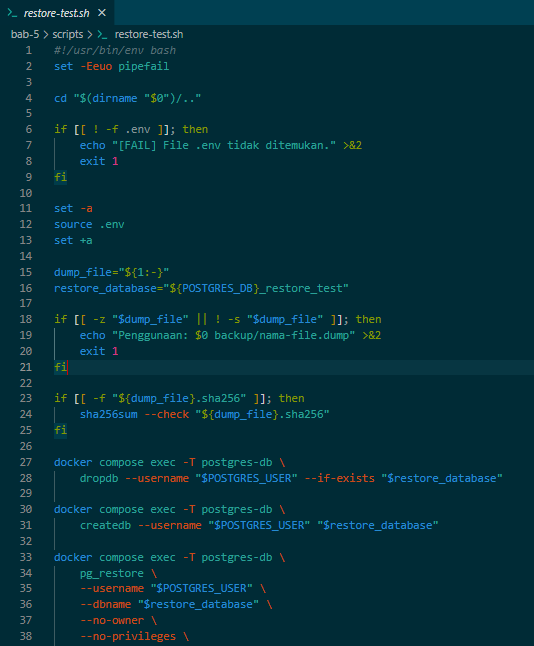
*Gambar 11: Berkas scripts/restore-test.sh (Validasi parameter dan checksum)*

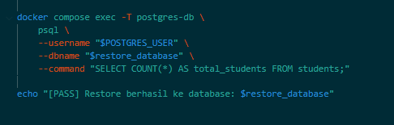
*Gambar 12: Berkas scripts/restore-test.sh (Eksekusi restore dan verifikasi row count)*

#### **Penjelasan dan Analisis:**
- **Tujuan:** Membuktikan bahwa berkas backup benar-benar dapat dipulihkan (*disaster recovery testing*) tanpa merusak atau menimpa data pada database produksi/utama.
- **Analisis Prosedur Restore:**
  - Skrip diawali dengan verifikasi *checksum* `sha256sum --check` untuk memastikan berkas dump tidak korup sebelum diproses.
  - Database terisolasi bernama `labdb_restore_test` dibuat khusus sebagai wadah pengujian.
  - Utilitas `pg_restore` memulihkan seluruh skema dan data dari berkas dump ke dalam database uji.
  - Kueri `SELECT COUNT(*)` mengeksekusi penghitungan jumlah baris tabel `students`. Jika jumlah baris sesuai dengan database asal, maka proses backup-restore terbukti valid 100%.

---

### G. Validasi Permission dan Menjalankan Stack

1. **Memberikan hak akses eksekusi dan memvalidasi konfigurasi Compose:**
   ```bash
   chmod +x scripts/backup.sh scripts/restore-test.sh
   docker compose config
   ```

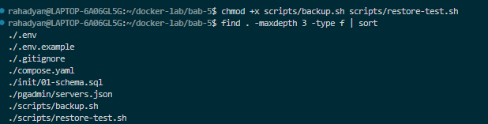
*Gambar 13: Perintah chmod +x dan verifikasi docker compose config*

2. **Menjalankan stack container:**
   ```bash
   docker compose up -d
   docker compose ps
   ```

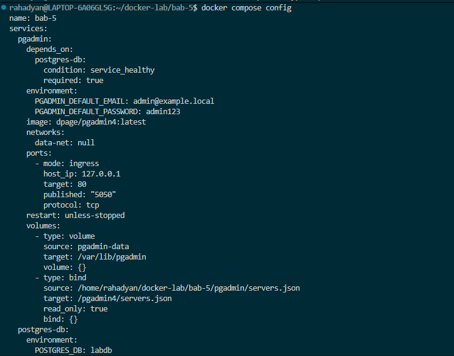
*Gambar 14: Proses download image dan inisialisasi docker compose up -d*

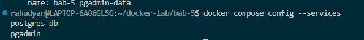
*Gambar 15: Hasil docker compose ps menunjukkan status healthy dan port forwarding*

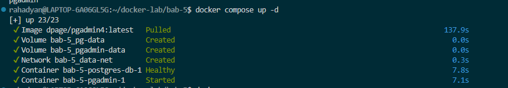
*Gambar 16: Log database dan pgAdmin membuktikan service berjalan normal*

3. **Mengakses Dashboard pgAdmin:**
   - Akses via peramban web: `http://localhost:5050`
   - Login menggunakan:
     - **Email:** `admin@example.local`
     - **Password:** `admin123`
   - Server `PostgreSQL Bab 5` langsung tersedia di menu Servers. Masukkan password PostgreSQL `labpass123` untuk menghubungkan.

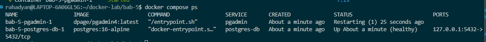
*Gambar 17: Antarmuka login web pgAdmin 4*

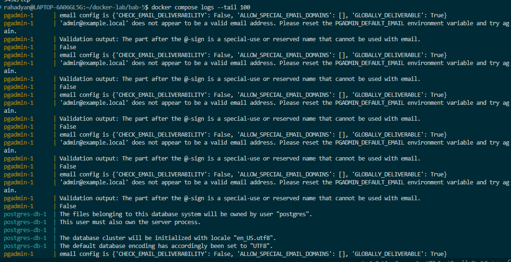
*Gambar 18: Halaman utama Dashboard pgAdmin 4*

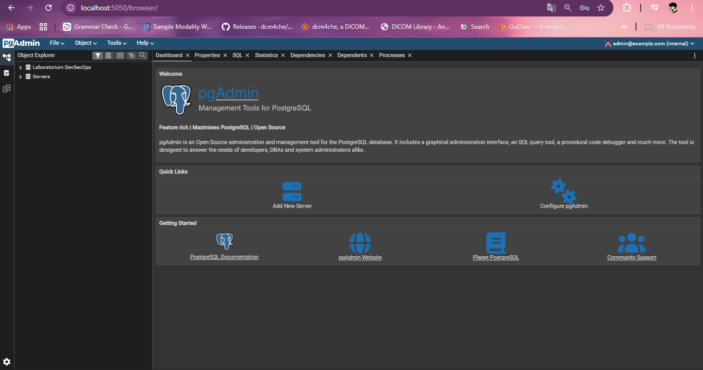
*Gambar 19: Server PostgreSQL Bab 5 terhubung dan skema labdb terdeteksi*

#### **Penjelasan dan Analisis:**
- **Perintah `chmod +x`:** Memberikan izin eksekusi (*executable permission*) pada skrip Bash.
- **Perintah `docker compose config`:** Memeriksa apakah sintaks YAML dan penggantian variabel lingkungan sudah benar tanpa ada kesalahan sebelum container dinyalakan.
- **Perintah `docker compose up -d` & `ps`:** Menjalankan seluruh container di latar belakang (*detached mode*). Output `docker compose ps` memperlihatkan service `postgres-db` bertransisi hingga berstatus `(healthy)` dan `pgadmin` berstatus `Up`.
- **Integrasi pgAdmin:** Berhasil login ke dashboard pgAdmin 4 dan menemukan server `PostgreSQL Bab 5` yang otomatis terdaftar mengonfirmasi bahwa penataan `servers.json` dan resolusi nama hostname `postgres-db` melalui Docker network berjalan dengan sukses.

---

### H. Pengujian Skema dan Data Awal

Memeriksa tabel dan data yang dibentuk otomatis oleh skrip `01-schema.sql`:

```bash
docker compose exec -T postgres-db \
  psql -U labuser -d labdb \
  -c "\dt"

docker compose exec -T postgres-db \
  psql -U labuser -d labdb \
  -c "SELECT id, nrp, name, created_at FROM students ORDER BY id;"
```

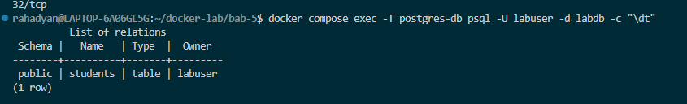
*Gambar 20: Hasil perintah \dt menampilkan tabel students*

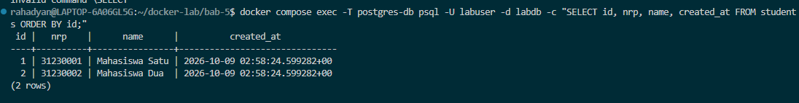
*Gambar 21: Hasil kueri SELECT menampilkan 2 data awal mahasiswa*

#### **Penjelasan dan Analisis:**
- **Hasil Kueri `\dt`:** Menampilkan tabel `students` yang dimiliki oleh `labuser`.
- **Hasil Kueri `SELECT`:** Menampilkan dua baris data awal (`31230001 - Mahasiswa Satu` dan `31230002 - Mahasiswa Dua`).
- **Analisis:** Hal ini membuktikan bahwa entrypoint container PostgreSQL berhasil mendeteksi direktori data yang masih kosong dan mengeksekusi berkas `01-schema.sql` dari folder `/docker-entrypoint-initdb.d` pada saat pertama kali volume dibuat.

---

### I. Pengujian Persistensi Data (Volume Persistence Test)

1. **Menambahkan data baru:**
   ```bash
   docker compose exec -T postgres-db \
     psql -U labuser -d labdb \
     -c "INSERT INTO students(nrp, name) VALUES ('31230003', 'Mahasiswa Tiga') ON CONFLICT DO NOTHING;"
   ```

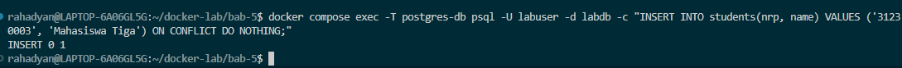
*Gambar 22: Penambahan data mahasiswa ketiga (31230003)*

2. **Mematikan container dan menyalakan kembali:**
   ```bash
   docker compose down
   docker compose up -d
   ```

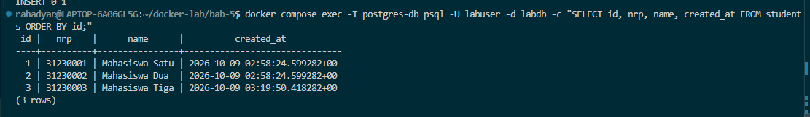
*Gambar 23: Eksekusi docker compose down dilanjutkan dengan up -d*

3. **Memverifikasi persistensi data:**
   ```bash
   docker compose exec -T postgres-db \
     psql -U labuser -d labdb \
     -c "SELECT nrp, name FROM students ORDER BY nrp;"
   ```

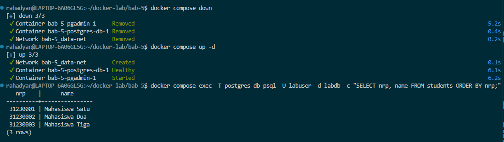
*Gambar 24: Kueri SELECT membuktikan ketiga record mahasiswa tetap bertahan*

#### **Penjelasan dan Analisis:**
- **Tujuan:** Menguji apakah data tetap bertahan ketika container PostgreSQL dihapus dari memori host.
- **Hasil Pengujian:** Setelah perintah `docker compose down` mengeksekusi penghentian dan penghapusan container, stack dinyalakan kembali via `docker compose up -d`. Hasil kueri `SELECT` membuktikan baris data `31230003` **tetap ada secara utuh**.
- **Analisis Teknis:** Keberhasilan ini disebabkan karena data PostgreSQL tidak disimpan pada *ephemeral layer* container, melainkan pada *named volume* Docker `pg-data` yang dikelola secara independen di sistem penyimpanan host.

---

### J. Eksekusi Backup dan Uji Restore

1. **Menjalankan backup dan verifikasi checksum SHA-256:**
   ```bash
   ./scripts/backup.sh
   ls -lh backup/
   sha256sum --check backup/*.dump.sha256
   ```

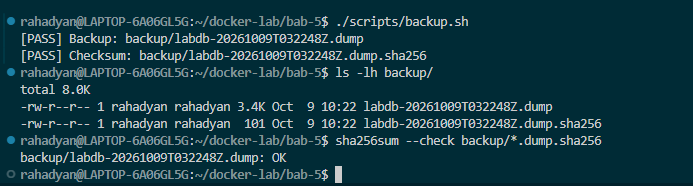
*Gambar 25: Eksekusi ./scripts/backup.sh menghasilkan file dump dan sha256*

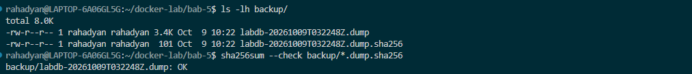
*Gambar 26: Hasil sha256sum --check menunjukkan status OK [PASS]*

2. **Menjalankan uji restore ke database terpisah:**
   ```bash
   latest_dump="$(find backup -maxdepth 1 -name '*.dump' -type f | sort | tail -n 1)"
   ./scripts/restore-test.sh "$latest_dump"
   ```

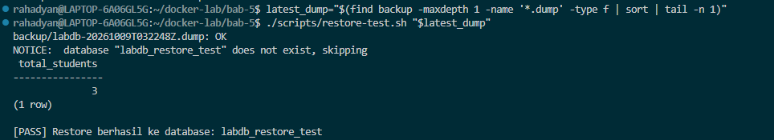
*Gambar 27: Eksekusi ./scripts/restore-test.sh memulihkan data ke labdb_restore_test*

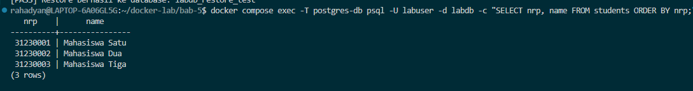
*Gambar 28: Hasil verifikasi SELECT COUNT(*) menampilkan 3 mahasiswa [PASS]*

3. **Memeriksa isi database hasil restore:**
   ```bash
   docker compose exec -T postgres-db \
     psql -U labuser -d labdb_restore_test \
     -c "SELECT nrp, name FROM students ORDER BY nrp;"
   ```

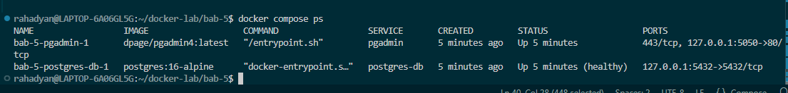
*Gambar 29: Kueri data pada database labdb_restore_test di terminal*

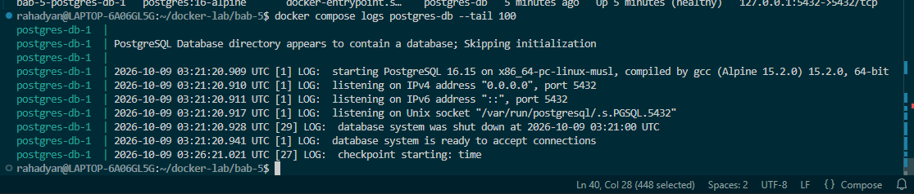
*Gambar 30: Database labdb_restore_test terlihat utuh pada antarmuka pgAdmin 4*

#### **Penjelasan dan Analisis:**
- Memanggil `./scripts/backup.sh` menghasilkan berkas biner `.dump` (berukuran > 0 byte) dan berkas sidik jari `.sha256`. Verifikasi `sha256sum --check` mengembalikan hasil `OK`, menandakan berkas backup utuh.
- Skrip `./scripts/restore-test.sh` berhasil membuat database isolasi `labdb_restore_test` dan memulihkan seluruh struktur data. Output kueri menampilkan `total_students = 3` beserta rincian 3 baris data mahasiswa yang identik dengan database asal. Ini mengonfirmasi bahwa prosedur *disaster recovery* dapat diandalkan 100%.

---

### K. Monitoring Dasar dan Lifecycle Cleanup

1. **Pengecekan monitoring kesehatan dan kapasitas storage:**
   ```bash
   docker compose exec -T postgres-db pg_isready -U labuser -d labdb
   docker compose exec -T postgres-db psql -U labuser -d labdb -c "SELECT version();"
   docker volume ls
   docker system df -v
   ```

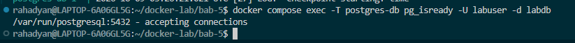
*Gambar 31: Perintah pg_isready memastikan database menerima koneksi*

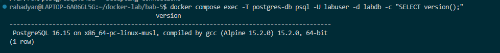
*Gambar 32: Kueri SELECT version() menampilkan versi PostgreSQL 16 Alpine*

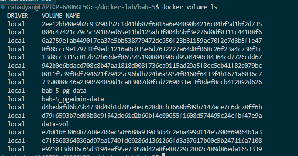
*Gambar 33: Perintah docker volume ls menampilkan volume pg-data dan pgadmin-data*

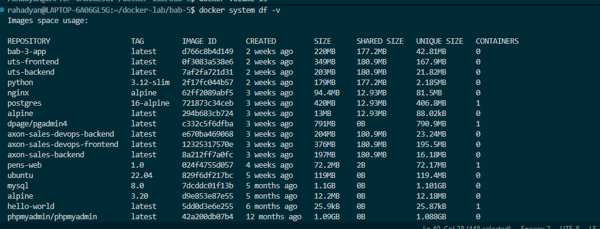
*Gambar 34: Perintah docker system df -v menganalisis ukuran disk volume*

2. **Prosedur Cleanup Aman:**
   - Menghapus database sementara uji restore:
     ```bash
     docker compose exec -T postgres-db \
       dropdb -U labuser --if-exists labdb_restore_test
     ```
   - Menghentikan container (data volume tetap tersimpan):
     ```bash
     docker compose down
     ```
   - *(Opsional)* Reset total termasuk menghapus volume data:
     ```bash
     docker compose down -v
     ```

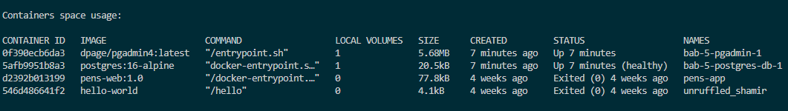
*Gambar 35: Menghapus database sementara labdb_restore_test dengan dropdb*

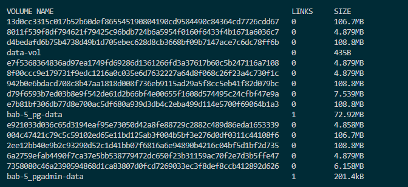
*Gambar 36: docker compose down menghentikan container sementara volume tetap aman*

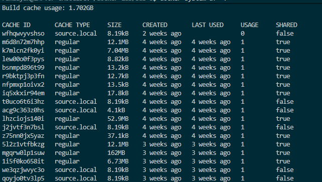
*Gambar 37: docker compose down -v menghapus container beserta seluruh data volume*

#### **Penjelasan dan Analisis:**
- Monitoring menggunakan `pg_isready` dan `SELECT version()` memastikan kondisi riil service database. Perintah `docker volume ls` dan `docker system df -v` menginspeksi penggunaan disk fisik oleh volume. Pembersihan dilakukan secara bertanggung jawab dengan membuang database uji terlebih dahulu sebelum menghentikan stack container.

---

### L. Challenge: Pencegahan Kebocoran Kredensial (.env) pada Lingkungan Production

**Pertanyaan:** *Bagaimana cara agar kredensial pada `.env` tidak terekspos ketika production pada lingkungan Docker?*

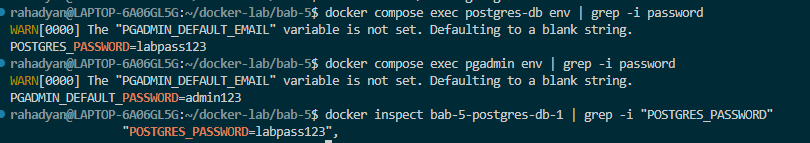
*Gambar 38: Pengujian keamanan dan verifikasi git status terhadap file .env*


*Gambar 39: Bukti pengabaian file kredensial pada commit history*

#### **Penjelasan Solusi Produksi (Production Hardening):**
1. **Docker Secrets (Swarm / Kubernetes Secrets):**
   Pada produksi, jangan gunakan variabel lingkungan plaintext pada `.env` atau `compose.yaml`. Gunakan fitur **Docker Secrets** di mana password disuntikkan secara dinamis sebagai file temporer pada `/run/secrets/db_password` yang hanya bisa dibaca oleh container yang berhak di dalam memori kernel.
2. **External Secret Management Service:**
   Gunakan solusi Secret Vault seperti **HashiCorp Vault**, **AWS Secrets Manager**, atau **Google Cloud Secret Manager**. Container aplikasi menarik token/kredensial secara terenkripsi saat proses booting (*runtime*).
3. **Penyisihan Git dan Pre-Commit Hooks:**
   Pastikan file `.env` selalu masuk dalam `.gitignore` dan gunakan alat pemindai seperti `git-secrets`, `TruffleHog`, atau `Gitleaks` pada pipeline CI/CD untuk menggagalkan *commit* jika terdapat pola password atau private key yang tidak sengaja tertulis.
4. **Prinsip Least Privilege:**
   Gunakan akun aplikasi khusus dengan hak akses terbatas (hanya `SELECT`, `INSERT`, `UPDATE` pada tabel tertentu), bukan menggunakan akun superuser `postgres` untuk operasional harian.

---

## 6. TROUBLESHOOTING DAN ANALISIS PERMASALAHAN

| Gejala / Permasalahan | Analisis Penyebab | Solusi & Tindakan Perbaikan |
|---|---|---|
| **Init SQL tidak dieksekusi ulang** | Volume `pg-data` sudah memiliki direktori database yang terbentuk sebelumnya. | Skrip init hanya aktif saat volume kosong. Jika ingin reset total, jalankan `docker compose down -v`. Pada produksi, gunakan skrip migrasi database. |
| **`pgAdmin` gagal koneksi ke DB** | Konfigurasi host mengarah ke `localhost` atau `127.0.0.1`. | Ganti hostname menjadi nama service Compose (`postgres-db`) karena pgAdmin berada pada network internal bridge yang berbeda container. |
| **`Permission denied` saat backup** | Host user tidak memiliki izin tulis pada folder `backup/`. | Pastikan folder `backup/` memiliki hak akses tulis user host (`chmod -R 755 backup/`). |
| **Restore Gagal / File Corrupt** | Berkas dump terpotong atau *checksum mismatch*. | Lakukan verifikasi `sha256sum --check` sebelum restore dan pastikan flag `--no-owner --no-privileges` disertakan pada `pg_dump`/`pg_restore`. |

---

## 7. CHECKLIST KELULUSAN (PASS CRITERIA)

- [x] Konfigurasi Compose valid tanpa galat (`docker compose config`).
- [x] Healthcheck PostgreSQL berstatus `healthy` menggunakan `pg_isready`.
- [x] Tabel `students` dan data awal terinisialisasi otomatis via `01-schema.sql`.
- [x] pgAdmin berhasil terhubung via hostname service `postgres-db`.
- [x] Persistensi terbukti (data tetap utuh setelah `docker compose down` dan `up`).
- [x] File backup `.dump` terbuat (> 0 byte) dengan validasi SHA-256 terverifikasi.
- [x] Uji pemulihan (*restore test*) berhasil pada database `labdb_restore_test`.
- [x] File kredensial (`.env`) dan dump diabaikan oleh git (`.gitignore`).

---

## 8. KESIMPULAN

1. **Persistensi Data Mutlak pada Stateful Container:** Docker named volume (`pg-data`) sukses menjaga integritas data aplikasi database PostgreSQL melintasi siklus hidup container (*stop*, *restart*, *down*, *rebuild*).
2. **Inisialisasi Otomatis:** Mekanisme `/docker-entrypoint-initdb.d` sangat efektif untuk otomatisasi skema dan *seed data* pada lingkungan pengujian/CI-CD, asalkan dikelola pada volume yang baru diinisialisasi.
3. **Orkestrasi dan Healthcheck Terpadu:** Penggunaan kondisi `service_healthy` pada Docker Compose mencegah timbulnya *race condition* atau *connection refused* pada pgAdmin dan aplikasi downstream.
4. **Verifikasi Backup yang Terukur:** Penerapan *logical dump* dengan pengujian *checksum* SHA-256 dan uji *restore* terisolasi ke database `labdb_restore_test` memenuhi standar DevSecOps untuk kesiapan *Disaster Recovery*.
