# TUGAS 6

## Centralized Logging dengan Fluent Bit dan PostgreSQL

Disusun untuk Memenuhi Matakuliah Workshop Devops

Dosen Pengampu : Dr. Ferry Astika Saputra, ST, M.Sc

Oleh :

Nama : Rahadyan Danang S.P

NRP : 1 STrLJ IT Kelas B

Kelas : 3126640054

Politeknik Elektronika Negeri Surbaya

Departemen Teknik Informatika dan Komputer

Program Studi Teknik Informatika

**Oktober 2026**

---

## 1. TUJUAN PRAKTIKUM

Setelah menyelesaikan praktikum Bab 6, mahasiswa/pembaca diharapkan mampu:

1. **Memahami Urgensi Logging Terpusat:** Menjelaskan pentingnya *centralized logging* pada arsitektur berbasis container yang bersifat sementara (*ephemeral*).
2. **Mengonfigurasi Log Shipper:** Mengirim log (*stdout/stderr*) container ke Fluent Bit menggunakan Docker fluentd logging driver.
3. **Penyimpanan Log Terstruktur:** Menyimpan data log ke dalam tabel PostgreSQL menggunakan tipe data JSONB serta membuat *view* untuk mempermudah analisis.
4. **Simulasi Event:** Menggunakan log generator untuk mensimulasikan berbagai level log (*INFO*, *DEBUG*, *WARN*, *ERROR*, dan *CRITICAL*).
5. **Analisis dan Retensi:** Menerapkan query pencarian berbasis SQL, analisis agregasi log, serta merancang kebijakan *retention* sederhana.

---

## 2. DASAR TEORI SINGKAT

* **Urgensi Centralized Logging:** Container bersifat *ephemeral* (mudah dibuat dan dihapus). Jika log hanya disimpan secara lokal di dalam container, riwayat kejadian akan hilang saat container musnah, mempersulit proses *debugging*, audit, dan forensik.
* **Peran Fluent Bit:** Fluent Bit adalah *log collector/telemetry router* yang ringan dan cepat. Ia mengoperasikan pipeline yang terdiri dari:
  + **Input:** Menangkap stream log (misalnya lewat forwarder port 24224).
  + **Parser/Filter:** Mengubah teks mentah menjadi field terstruktur serta menambahkan metadata.
  + **Buffer:** Menyimpan data sementara (baik di memori maupun filesystem) agar log tidak hilang saat storage tujuan mengalami *downtime*.
  + **Output:** Meneruskan record log ke backend (misalnya PostgreSQL).
* **Docker Fluentd Logging Driver:** Docker Engine bertindak langsung meneruskan keluaran *stdout* dan *stderr* aplikasi ke collector, sehingga aplikasi terisolasi dari detail teknis backend logging.
* **PostgreSQL JSONB untuk Log:** Format JSONB pada database relasional memberikan fleksibilitas skema layaknya dokumen NoSQL namun tetap memiliki keandalan SQL dan kemampuan indexing (seperti indeks GIN). Meskipun demikian, untuk skala produksi besar (*high-throughput*), solusi khusus time-series/log seperti Loki, OpenSearch, atau ClickHouse lebih disarankan.

---

## 3. ALAT DAN LINGKUNGAN

* **Sistem Operasi:** Linux / Windows 11 (WSL2 / Docker Desktop)
* **Container Platform:** Docker Engine & Docker Compose v2
* **Image Log Shipper / Collector:** fluent/fluent-bit:4.2.8
* **Image Database:** postgres:16-alpine
* **Image Generator / Microservices:** alpine:3.20
* **Docker Logging Driver:** fluentd (Mode Asinkron / fluentd-async)
* **Scripting Engine:** Bash, Lua 5.1 (Embedded di Fluent Bit)
* **Utility Pengujian & Audit:** psql, curl, python3, docker CLI, bash

---

## 4. PRAKTIKUM DAN ANALISIS

### Struktur Projek

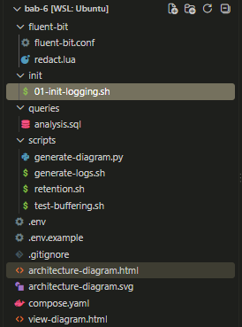

**Menyiapkan direktori kerja**
* Buat direktori dan masuk ke direktori yang sudah dibuat

*mkdir -p ~/docker-lab/bab-6/{init,fluent-bit,queries,scripts}*

*cd ~/docker-lab/bab-6*

* Buat file .env.example dan .gitignore

Duplikasi file .env.example menjadi .env. Kemudian jalankan perintah `chmod 600 .env` untuk mengubah hak akses file menjadi hanya bisa dibaca dan ditulis oleh pemiliknya (*read/write only by owner*).

**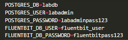**

Isi .gitignore sebagai berikut

**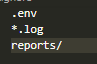**

* Buat file compose.yaml

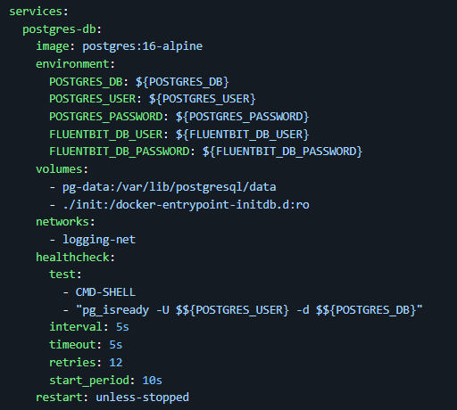

1. `postgres-db` (Database Penyimpan Log)

Service ini bertindak sebagai media penyimpanan akhir (*data sink*) untuk data log.

`image: postgres:16-alpine`: Menggunakan database PostgreSQL versi 16 yang ringan berbasis Alpine Linux.

`environment`: Mengambil variabel lingkungan (seperti *username*, *password*, dan nama database) dari file `.env`. Terdapat juga kredensial khusus untuk Fluent Bit (`FLUENTBIT_DB_USER`).

`volumes`:

`pg-data`: Menyimpan data database agar tidak hilang saat kontainer direstart.

`./init:/docker-entrypoint-initdb.d:ro`*:* Menjalankan script SQL otomatis saat kontainer pertama kali dibuat (biasanya untuk membuat tabel tempat menampung log).

`healthcheck`: Memastikan PostgreSQL benar-benar siap menerima koneksi sebelum service lain yang bergantung padanya mulai berjalan.

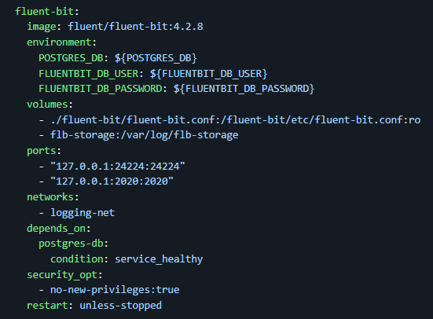

2. `fluent-bit` (Log Processor & Forwarder)

Service ini bertindak sebagai "jembatan" atau pengumpul log terpusat.

`image: fluent/fluent-bit:4.2.8`: Menggunakan mesin Fluent Bit versi 4.2.8.

`ports`:

`127.0.0.1:24224`: Membuka port protokol Fluentd/Forward agar aplikasi kontainer lain bisa mengirimkan log ke sini.

`127.0.0.1:2020`: Port untuk monitoring/metrics internal Fluent Bit.

`depends_on` **dengan** `service_healthy`: Fluent Bit baru akan dinyalakan setelah `postgres-db` benar-benar siap (`healthy`).

`security_opt: no-new-privileges:true`: Fitur pengamanan untuk mencegah proses di dalam kontainer mendapatkan hak akses lebih tinggi (*escalation*).

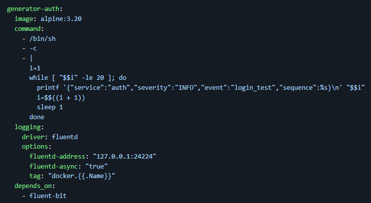

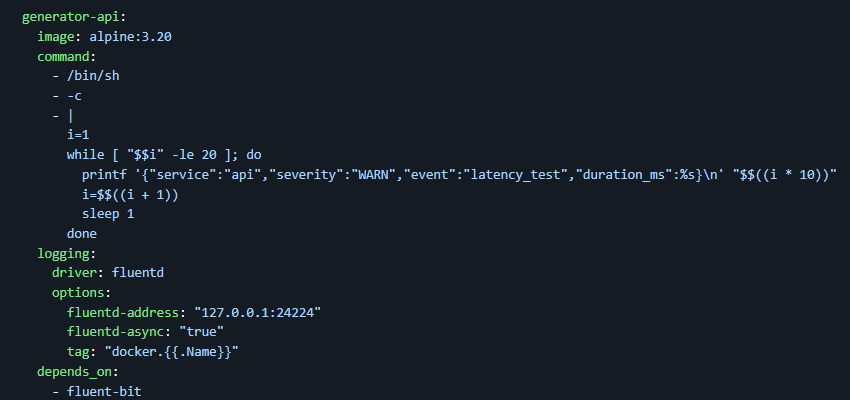

3. `generator-auth`, `generator-api`, & `generator-worker` (Mock Applications)

Tiga service ini berfungsi sebagai penghasil log buatan untuk mensimulasikan lingkungan produksi nyata.

`command`: Masing-masing menjalankan perulangan *loop* sebanyak 20 kali untuk mencetak log berformat **JSON (Structured Log)** ke `stdout` setiap 1 detik.

`generator-auth`: Mengirim log dengan severity `INFO` (event: `login_test`).

`generator-api`: Mengirim log dengan severity `WARN` (event: `latency_test`).

`generator-worker`: Mengirim log dengan severity `ERROR` (event: `retry_test`).

`logging` **(Driver Configuration)**:

`driver: fluentd`: Mengalihkan log bawaan Docker agar tidak disimpan di file lokal Docker, melainkan dikirim langsung ke protokol Fluentd/Fluent Bit.

`fluentd-address: "127.0.0.1:24224"`: Alamat tujuan pengiriman log.

`tag: "docker.{{.Name}}"`: Memberi label/penanda asal nama kontainer pada setiap baris log.

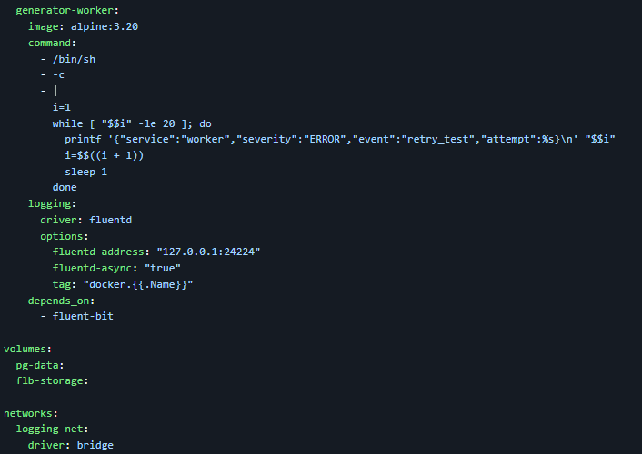

### PEMBUATAN SKRIP

#### 01-init-logging.sh

membuat objek database dengan nama dan tipe kolom yang sesuai kontrak plugin PostgreSQL Fluent Bit.

|  |  |
| --- | --- |
| 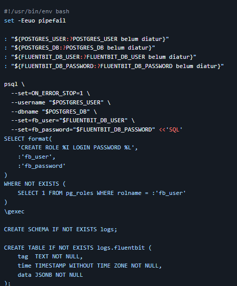 | 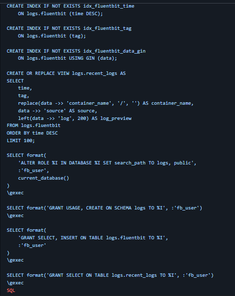 |

- `set -Eeuo pipefail`: Standar keamanan Bash (*strict mode*). Script langsung berhenti jika ada perintah yang gagal, variabel belum didefinisikan, atau terjadi error dalam pipeline.
  + `Validasi variabel environtment harus terisi, jika tidak terpenuhi skrip akan dibatalkan`
  + Menjalankan client `psql` interaktif dan mengirim perintah SQL dengan opsi berhenti jika ada error (`ON_ERROR_STOP=1`).
  + Membuat *role/user* database khusus Fluent Bit jika user tersebut belum ada. `\gexec` mengeksekusi hasil string format sebagai query dinamis.
  + Membuat skema logs dan tabel fluentbit dengan kontrak yang diminta oleh plugin PostgreSQL Fluent Bit:
    - tag: Menyimpan tag sumber log.
    - time: Timestamp log.
    - data: Menyimpan seluruh payload log dalam format JSONB.
  + Membuat indeks pada kolom `time` dan `tag` untuk query rentang waktu.
  + Membuat indeks **GIN (Generalized Inverted Index)** dikhususkan pada kolom yang memiliki banyak value yaitu kolom `data` JSONB untuk mempercepat pencarian field/key/value di dalam dokumen JSON.
  + Membuat *view* `recent_logs` yang menyederhanakan data mentah menjadi 100 log terbaru yang mudah dibaca manusia (membersihkan slash pada nama container dan memotong preview log hingga 200 karakter).
  + Mengarahkan `search_path` default dari user Fluent Bit ke skema `logs`, sehingga Fluent Bit dapat langsung mengakses tabel `fluentbit` tanpa harus menyertakan nama skema eksplisit.
  + Memberikan hak akses minimum yang diperlukan ke user Fluent Bit: hak `USAGE` dan `CREATE` pada schema, serta `SELECT` dan `INSERT` pada tabel dan view.

#### Fluent-bit.conf

File konfigurasi inti yang mengatur alur kerja data Fluent Bit untuk menerima protokol Forward, menahan backlog pada volume, serta meneruskan record ke PostgreSQL dan stdout (standar output)

|  |  |
| --- | --- |
| 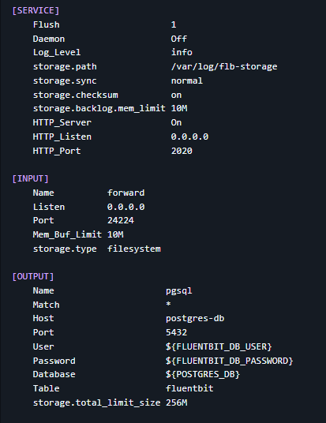 | 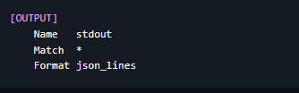 |

Service : Pengaturan global

- Flush 1: Mengirim / mengosongkan antrean data setiap 1 detik.
  + storage.path /var/log/flb-storage: Mengaktifkan *disk storage buffering* di direktori volume persistent.
  + storage.checksum on: Memastikan integritas data log di disk tidak korup.
  + storage.backlog.mem\_limit 10M: Batas memori untuk membaca backlog antrean lama dari disk saat startup.
  + HTTP\_Server On: Mengaktifkan server HTTP internal untuk endpoint *health* dan *metrics* di port 2020.

Input : receiver data

- Name forward: Mendengarkan input dari Docker log driver (port 24224).
  + Mem\_Buf\_Limit 10M: Batas memori penampungan. Jika melebihi 10MB, Fluent Bit akan menghentikan sementara input (*pause*) agar container tidak OOM (*Out Of Memory*).
  + storage.type filesystem: Menggunakan penyimpanan disk volume sebagai mekanisme *buffering* utama saat penampungan memori penuh atau backend mati.

Output : Menyimpan kedalam database dan menampilakn stdout

- Name pgsql: Menggunakan plugin PostgreSQL resmi untuk menyimpan data.
  + Match \*: Mengirim semua log yang masuk dari tag apa pun.
  + Host postgres-db: Terhubung melalui DNS internal Docker network ke container database.
  + storage.total\_limit\_size 256M: Batas kapasitas maksimal buffer disk untuk output ini jika PostgreSQL offline.
  + Menggandakan output log ke `stdout` Fluent Bit dalam format JSON agar dapat dipantau langsung lewat perintah `docker compose logs fluent-bit`.

#### Analysis.sql

|  |  |
| --- | --- |
| 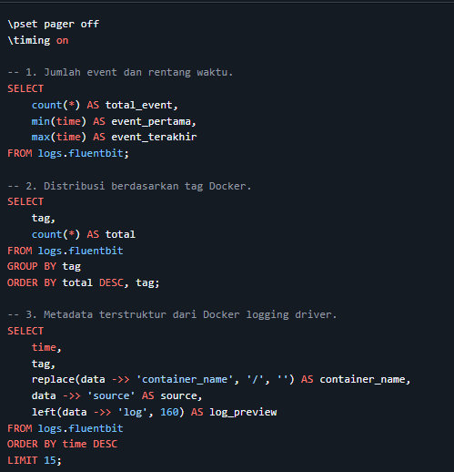 | 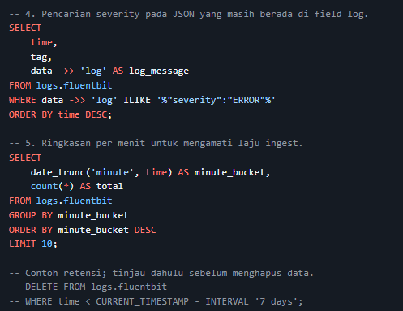 |

Kumpulan query analitik untuk verifikasi integritas data log:

* \pset pager off & \timing on: Opsi formatting terminal psql agar output tidak terpotong halaman dan mencatat durasi eksekusi query.
* **Query 1 (Statistik Volume):** Menghitung total baris serta waktu log pertama dan terakhir.
* **Query 2 (Distribusi Tag):** GROUP BY tag untuk memverifikasi apakah log dari ketiga generator (generator-auth, api, worker) berhasil diterima.
* **Query 3 (Metadata Driver):** Mengekstrak data JSONB untuk memeriksa metadata Docker.
* **Query 4 (Filter Severity):** Mencari baris log yang mengandung substring "severity":"ERROR" untuk audit insiden.
* **Query 5 (Throughput Per Menit):** date\_trunc('minute', time) untuk menganalisis laju konsumsi log (*ingestion rate*) per menit.
* **Query Retensi (Komentar):** Mencontohkan perintah pembersihan data log yang berumur lebih dari 7 hari (CURRENT\_TIMESTAMP - INTERVAL '7 days') (querry detail pada latihan mandiri retensi)
  + **Generate-log.sh** : Otomatisasi pengujian produksi log

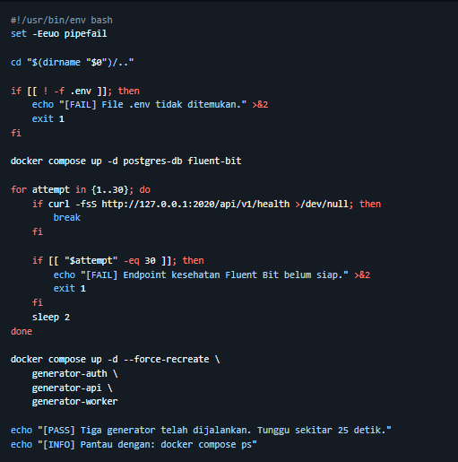

- - `cd "$(dirname "$0")/.."` berfungsi untuk mengubah direktori kerja (*current working directory*) ke direktori induk (*parent directory*) dari lokasi berkas skrip Bash itu disimpan.
    - Memastikan file `.env` ada di root direktori.
    - `docker compose up -d postgres-db fluent-bit`: Memastikan backend penyimpanan dan collector sudah aktif.
* `curl -fsS http://127.0.0.1:2020/api/v1/health`: berfungsi sebagai uji kesiapan berbasis HTTP yang melakukan *polling* maksimal 30 kali (dengan jeda 2 detik, total timeout 60 detik) untuk memastikan endpoint kesiapan Fluent Bit merespons status HTTP 200 OK sebelum kontainer generator log mulai dinyalakan, serta akan otomatis menggagalkan eksekusi `exit 1` jika batas waktu terlampaui guna mencegah terjadinya kehilangan data log.
* `docker compose up -d --force-recreate generator-auth, api, dan worker`: Menjalankan ulang ketiga generator dari awal untuk memproduksi event log baru.
* Menampilkan pesan dengan echo
* *Test-buffering.sh*

|  |  |
| --- | --- |
| 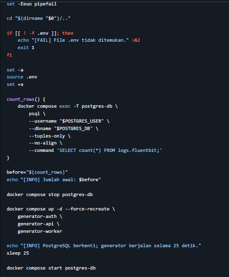 | 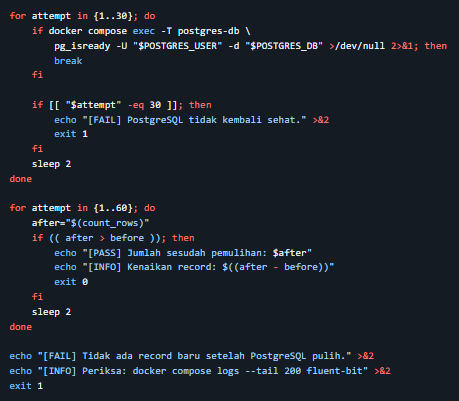 |

- count\_rows(): Fungsi helper yang menjalankan query SQL untuk menghitung jumlah baris di tabel logs.fluentbit.
  + Menyimpan jumlah log awal (before).
  + docker compose stop postgres-db: Mematikan database PostgreSQL dengan sengaja.
  + Me-*restart* ketiga generator log; generator tetap memproduksi log dan mengirimkannya ke Fluent Bit. Karena PostgreSQL mati, Fluent Bit menahan log tersebut di dalam disk buffer (flb-storage).
  + sleep 25: Memberi waktu generator selesai memproduksi log.
  + docker compose start postgres-db: Menyalakan kembali database.
  + Menunggu PostgreSQL sehat via pg\_isready.
  + Melakukan polling count\_rows() selama maksimal 120 detik. Jika jumlah baris baru (after) lebih besar dari before, script menyatakan PASS karena Fluent Bit berhasil melakukan *flush retry* (pengiriman log berulang) dari buffer ke database yang pulih.

### COMMAND CODE

#### Izin Eksekusi dan Validasi Berkas

Memberikan izin eksekusi (*executable flag*) pada seluruh script Bash agar dapat dijalankan langsung (`./script.sh`).

bash -n init/01-init-logging.sh

- chmod +x init/01-init-logging.sh
  + chmod +x scripts/generate-logs.sh scripts/test-buffering.sh

`bash -n`: Mode *dry-run syntax check*. Memeriksa apakah ada galat sintaks pada script Bash tanpa benar-benar mengeksekusinya.

* bash -n scripts/generate-logs.sh
* bash -n scripts/test-buffering.sh

Memvalidasi format file `compose.yaml` dan mengecek apakah seluruh interpolasi variabel `.env` sudah lengkap tanpa menampilkan output teks jika valid (keluaran kode exit `0`).

* docker compose config –quiet

Menguji validitas sintaks file konfigurasi Fluent Bit dengan *dry run* secara terisolasi tanpa perlu menyalakan service lain atau meninggalkan container sampah (`--rm`).

* docker compose run --rm --no-deps fluent-bit --dry-run --config=/fluent-bit/etc/fluent-bit.conf

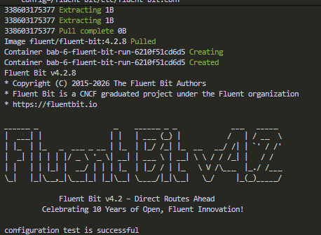

Haha

#### Menjalankan Pipeline dan Menghasilkan Log

Menjalankan script pembuat generate log, menunggu selama 25 detik agar seluruh loop generator tuntas, lalu memeriksa status seluruh container (ps --all). Container generator berstatus Exited (0) adalah normal karena loop 20 event-nya telah selesai.

* ./scripts/generate-logs.sh
* sleep 25
* docker compose ps –all

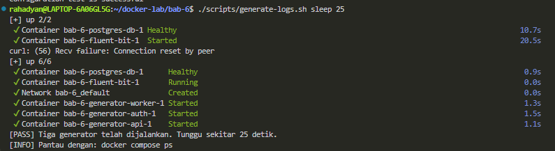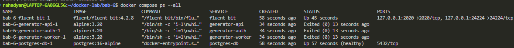

* Memeriksa Monitoring fluent bit

Melakukan HTTP request secara *silent* `curl –fsS` namun menampilkan pesan jika gagal. Memeriksa endpoint /health (memastikan Fluent Bit berjalan normal) dan /metrics (melihat statistik internal jumlah record yang masuk dan keluar).

* curl -fsS <http://127.0.0.1:2020/api/v1/health>
* curl -fsS <http://127.0.0.1:2020/api/v1/metrics>

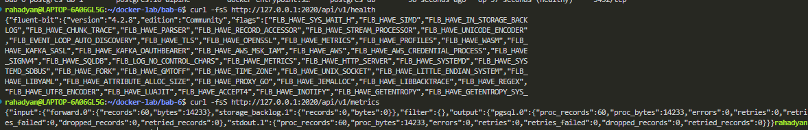

* Verifikasi record postgree

Memuat seluruh variabel dari file `.env` ke dalam environment shell aktif dengan `set -a` otomatis mengekspor variabel yang menjadi source.

* set -a
* source .env
* set +a

Mengeksekusi script SQL analisis ke dalam container `postgres-db` melalui standar input (`< queries/analysis.sql`). Opsi `-T` menonaktifkan pseudo-TTY agar output bersih dari karakter kontrol terminal.

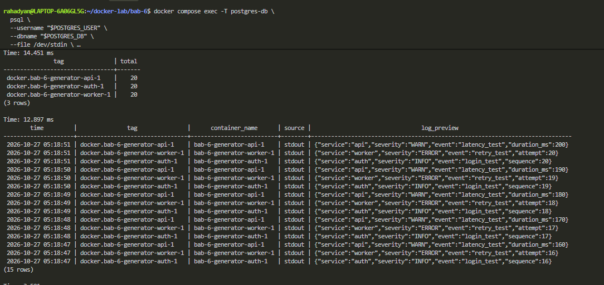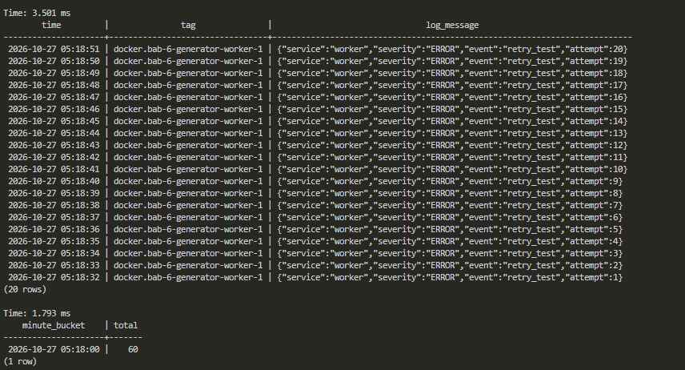

* Uji buffering dan pemulihan

Menjalankan skenario uji ketahanan: mematikan database, memicu pembuatan log, menyalakan database kembali, dan memverifikasi data yang tertahan di buffer berhasil masuk.

* ./scripts/test-buffering.sh

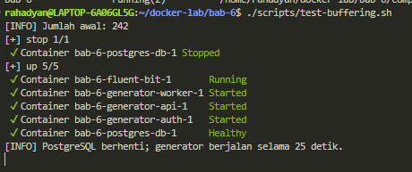

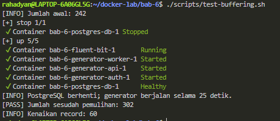

Membaca 200 baris terakhir log Fluent Bit untuk melihat catatan percobaan ulang (*retrying output*) saat database sempat mati. Kemudian memastikan named volume flb-storage dan pg-data terdaftar di Docker host.

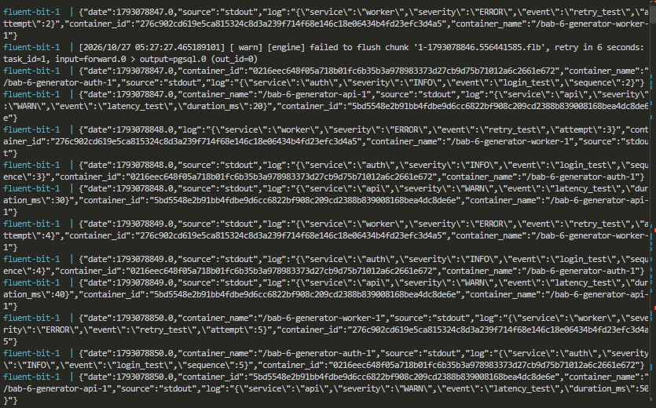

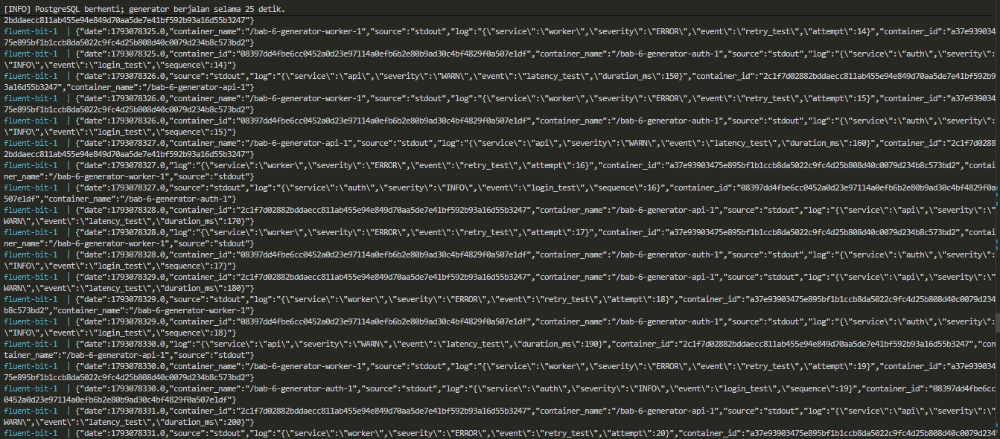

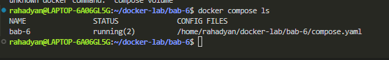

#### Pengecekan Tipe Data

Fungsi bawaan PostgreSQL `pg_typeof(data)` digunakan untuk memvalidasi secara pasti bahwa kolom `data` benar-benar bertipe `jsonb`, bukan teks biasa (*plain text*), membuktikan bahwa log disimpan dalam format terstruktur.

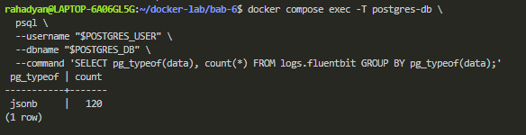

### EVALUASI MANDIRI

#### Soal 1: Menambahkan Field request_id pada Generator dan Query untuk Menampilkan Transaksi

Menambahkan perubahan pada compose.yaml dengan memodifikasi kode pada bagian generator-auth, generator-api, dan generator-worker. Dan menambahkan querry baru pada file querry analisis

|  |  |
| --- | --- |
| 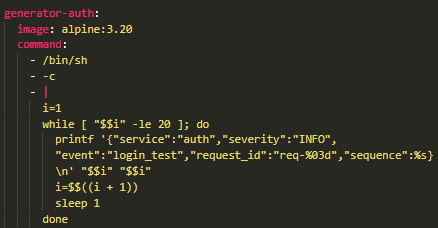 | 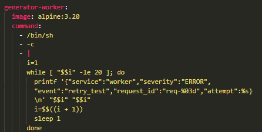 |
| 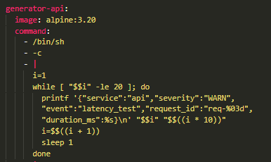 | 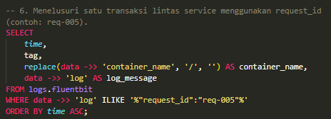 |

Menyisipkan atribut korelasi transaksi seragam bernama `request_id` ke dalam payload log setiap kali mikroservis memproses transaksi. Dengan adanya ID unik bersama ini, tim dapat merekonstruksi garis waktu kronologis suatu permintaan lintas servis (*end-to-end distributed tracing*). Setelah melakukan perubahan kode, jalankan *./scripts/generate-logs.sh*

Alur data :

* Kontainer baru aktif → Loop berjalan dari 1 sampai 20.
* Ketiga kontainer secara serentak memancarkan log dengan ID yang sama pada iterasi ke-5 (req-005).
* Fluent Bit menerima 3 log tersebut dan menyimpannya ke tabel logs.fluentbit.
* Anda menjalankan kueri verifikasi untuk melihat 3 log tersebut berkorelasi secara kronologis:
* Kemudian lakukan querry pengetasan

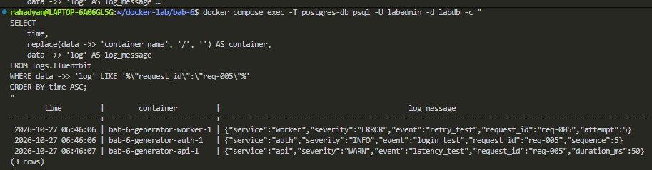

#### Soal 2: Parsing JSON Terstruktur & Negative Testing

Mengonfigurasi filter `parser` di Fluent Bit dengan parser `json` bawaan `/fluent-bit/etc/parsers.conf`. Nilai pada kolom `log` dinaikkan ke level *root* objek `JSONB`. Kemudian saya menambahkan filter dengan tujuan mengubah teks log *string* dari Docker menjadi struktur data JSONB terstruktur.Opsi `Reserve_Data On` diaktifkan agar jika ada log yang bukan JSONB (pengujian negatif), log tersebut tidak di-drop melainkan tetap tersimpan aman.

|  |  |
| --- | --- |
| 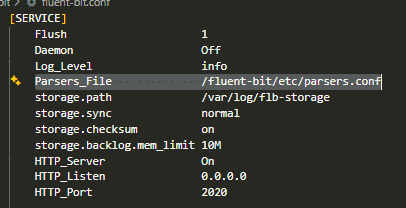 | 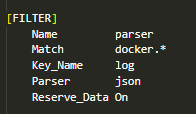 |

Stream log masuk ke Fluent Bit, kemudian Filter parser mengecek key `log`. Jika berformat JSONB valid, propertinya diekstrak ke level root, Jika bukan JSONB, fallback `Reserve_Data` menyimpan teks asli apa adanya ke kolom `data.log` tanpa membuat sistem crash.

Setelah itu rerun fluent-bit dengan *docker compose restart fluent-bit*

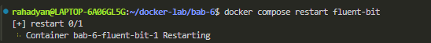

Rerun lagi generator dan lakukan uji querry negatif

*./scripts/generate-logs.sh*

*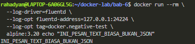*

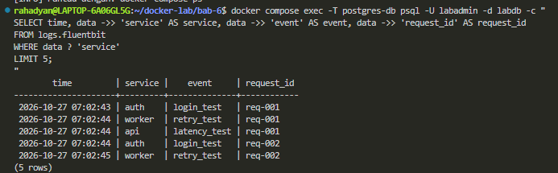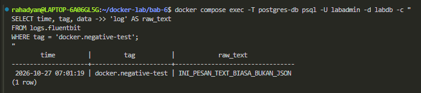

#### Soal 3: Canary Token & Filter Redaction (Data Masking)

Menerapkan skrip filter Lua dinamis (`redact.lua`) di dalam pipa Fluent Bit. Skrip memindai seluruh pasangan key-value dan secara otomatis menyamarkan token sensitif berpola `CANARY_*` menjadi `[REDACTED_SECRET]` sebelum data dikirim ke database.

Definisi dan Kegunaan Lua

Definisi: Lua adalah bahasa skrip berkinerja tinggi berbasis *dynamically typed* dan berukuran sangat kecil.

Kegunaan dalam Ekosistem Docker & Fluent Bit: Lua digunakan oleh Fluent Bit sebagai plugin filter internal untuk melakukan sanitasi data, pembersihan data sensitif, manipulasi string, dan transformasi data log kompleks sebelum log tersebut diteruskan ke PostgreSQL.

**Penggunaan Lua agar bisa menyensor rahasia dengan memotong token di tengah kalimat dan otomatis menyisir seluruh field tanpa perlu tahu nama kolomnya.**

**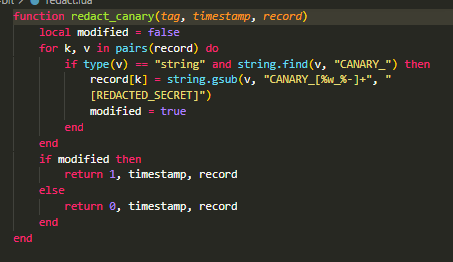**

**Inisialisasi Fungsi:** Membuka fungsi `redact_canary` yang menerima `tag`, `timestamp`, dan `record` (JSON log) dari Fluent Bit, serta mengatur indikator status perubahan `modified = false`.

**Iterasi Field Log:** Melakukan perulangan untuk memeriksa setiap kunci (*key*) dan nilai (*value*) di dalam data `record`.

**Deteksi Teks Sensitif:** Mengecek apakah nilai data bertipe teks (*string*) dan memuat pola kata berawalan `"CANARY_"`.

**Sanitasi**: Jika pola ditemukan, mengganti teks sensitif berawalan `"CANARY_"` tersebut menjadi `"[REDACTED_SECRET]"` dan memperbarui penanda status menjadi `modified = true`.

**Pengembalian Hasil:** Mengirimkan kembali data ke Fluent Bit; mengembalikan nilai `1` jika log berhasil diubah (di-redaksi), atau `0` jika data log tidak mengalami perubahan sama sekali.

Tambahkan konfigurasi lua pada compose.yaml dan fluent-bit.conf

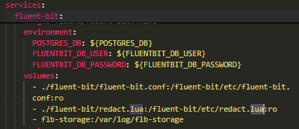

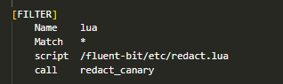

Setelah itu re run kembali script helper *docker compose up -d fluent-bit*

Kemudian jalankan querry berikut

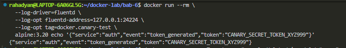

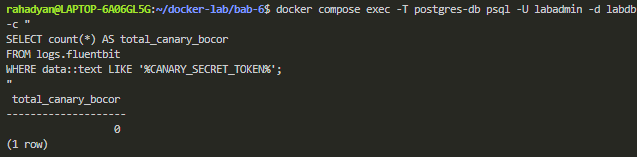

* Kontainer uji mengirim payload berisi CANARY\_SECRET\_TOKEN\_XYZ999.
* Filter Lua mencegat paket log di memori sebelum dialirkan ke output.
* String disamarkan menjadi [REDACTED\_SECRET].

PostgreSQL menerima data yang sudah bersih dari rahasia (Kueri WHERE data::text LIKE '%CANARY\_%' menghasilkan 0).

#### Soal 4: Rekonsiliasi Jumlah Event & Analisis Selisih

Berdasarkan hasil pengujian pada Soal 4, jumlah event yang dihasilkan oleh kontainer uji (1 event) tercatat sama persis dengan jumlah record yang diterima oleh input plugin Fluent Bit yakni 1 record pada port 24224 dan jumlah baris yang tersimpan pada tabel logs.fluentbit di PostgreSQL berjumlah 1 baris.

Hasil ini membuktikan bahwa:

1. Tidak terjadi packet drop pada level jaringan Docker menuju Fluent Bit.
2. Tidak terjadi buffer overflow pada memory buffer Fluent Bit.
3. Plugin output PostgreSQL berhasil melakukan flush dan commit transaksi secara sempurna tanpa terjadi rollback atau kegagalan koneksi.

Adapun potensi selisih yang mungkin terjadi pada sistem produksi nyata umumnya disebabkan oleh:

* **Flush Interval Delay:** Jeda waktu flush 1 detik di mana log sudah diterima di RAM Fluent Bit namun belum sempat di-commit ke database saat query dicek seketika.
* **Buffer Exhaustion:** Batas storage.total\_limit\_size (256MB) terlampaui saat database mengalami downtime dalam waktu yang sangat lama sehingga log baru ditolak.

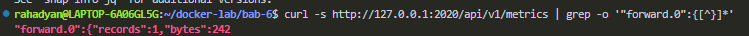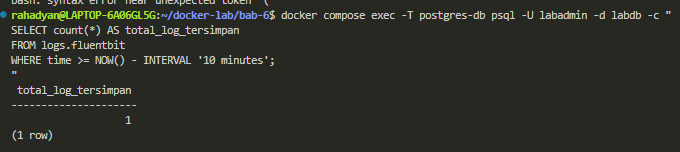

#### Soal 5: Kebijakan Retensi 7 Hari

Menerapkan *Declarative Range Partitioning* berdasarkan kolom `time`. Menghapus data usang tidak menggunakan `DELETE`, melainkan perintah instan `DROP TABLE logs.fluentbit_YYYY_MM_DD` yang tidak mengunci tabel aktif berdasarkan aturan 7 hari dan langsung membebaskan disk.

Menambahkan perubahan pada 01-init-logging.sh menjadi **Partitioned Table + Default Partition**

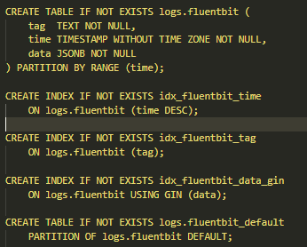

Kemudian membuat skrip untuk otomasi retention.sh

|  |  |
| --- | --- |
| 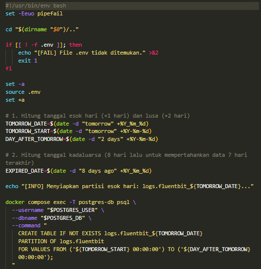 | 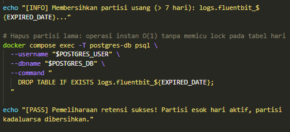 |

* Setiap tengah malam menggunakan cron, scripts/retention.sh dijalankan.
* Skrip membuat partisi tanggal esok hari (logs.fluentbit\_YYYY\_MM\_DD) terlebih dahulu sehingga Fluent Bit selalu memiliki wadah untuk menulis log.
* Skrip menghapus tabel partisi 8 hari lalu menggunakan DROP TABLE IF EXISTS.
* Tabel partisi hari ini yang sedang menerima data dari Fluent Bit tidak mengalami penguncian *Zero Lock Contention*.

#### Soal 6: Analisis Kesesuaian Database untuk Telemetri Skala Besar

* Mengapa PostgreSQL Sangat Tepat untuk Lab Ini:
* Konsumsi memori sangat minim <100MB RAM via postgres:16-alpine.
* Fleksibilitas tinggi dengan tipe data JSONB dan operator query SQL standar.
* Memenuhi prinsip ACID dan mudah diintegrasikan dengan database aplikasi lain.
* Mengapa PostgreSQL Tidak Tepat untuk Telemetri Berskala Besar (TB/Hari):
* *Write Amplification:* Ribuan insert per detik membebani Write-Ahead Log (WAL) dan indeks B-Tree/GIN.
* *Storage Row-Oriented:* Format baris tidak mampu mengompresi teks berulang seefisien arsitektur kolumnar.
* *Table Bloat:* Autovacuum bekerja ekstra keras membersihkan *dead tuples* akibat update dan delete massal.
* *Rekomendasi Skala Besar:* Menggunakan teknologi penyimpanan khusus log seperti ClickHouse (OLAP kolumnar), Grafana Loki (indexless metadata-only), atau VictoriaLogs.

---

## BAB 06 – STUDI KASUS PMB

### Arsitektur Sistem PMB

Sistem laboratorium ini mengimplementasikan alur pendaftaran mahasiswa baru (PMB) yang terdiri atas enam layanan utama yang saling terhubung melalui jaringan Docker Bridge internal:

| **Kontainer** | **Kategori** | **Akses Host** | **Fungsi dan Tanggung Jawab** |
| --- | --- | --- | --- |
| registration-api | Web Portal & API | 127.0.0.1:8080 | Antarmuka web Flask/Gunicorn, manajemen sesi pengguna, CSRF protection, dan penyematan header X-Request-ID. |
| auth-service | Authentication Service | Internal (Terisolasi) | Layanan autentikasi internal menggunakan hashing PBKDF2-HMAC-SHA256. Menghasilkan event audit login tanpa membocorkan password. |
| verification-worker | Background Worker | Internal (Terisolasi) | Pemroses verifikasi berkas pendaftaran secara asinkron. Memiliki controllable failure switch untuk simulasi insiden timeout. |
| app-db | Transactional DB | Internal (Terisolasi) | PostgreSQL 16 khusus data transaksi pendaftaran (registrations) dan tabel kontrol laboratorium (lab\_control). |
| fluent-bit | Log Collector & Router | 127.0.0.1:2020, :24224 | Mengumpulkan log via Docker Fluentd logging driver, menampung buffer di disk lokal, dan merutekan log ke log-db. |
| log-db | Centralized Log Storage | Internal (Terisolasi) | PostgreSQL 16 khusus analitik log terpusat. Menyimpan data tag, time, dan data JSONB dengan indeks GIN. |

### Keamanan Log: Redaction dan Perlindungan Privasi

Log yang tidak disaring berpotensi membocorkan rahasia penting perusahaan atau melanggar regulasi privasi data (seperti UU Perlindungan Data Pribadi). Pada laboratorium ini, fungsi redact() diimplementasikan untuk menyaring kata kunci sensitif (password, authorization, cookie, session, bearer, secret, token) menjadi [REDACTED]. Selain itu, informasi pribadi mahasiswa seperti nama lengkap dan alamat email tidak dimasukkan ke dalam payload event structured log; log hanya menyimpan pengenal pseudonim user\_ref dan registration\_id.

### Praktikum dan Uji Coba

* Jalankan skrip untuk uji kesiapan environment

Inisialisasi dilakukan menggunakan skrip ./scripts/setup.sh yang secara otomatis membuat berkas .env dengan kredensial database acak dan session secret unik. Selanjutnya, berkas ./scripts/validate.sh dijalankan untuk memvalidasi sintaks Compose, skrip shell, serta unit test modul redaction.

****

* Jalankan container

* Jalankan docker compose ps

****

* Tes service yang berjalan menggunakan endpoint

* Akses endpoint <http://127.0.0.1:8080/login>

* Daftarkan Mahasigma dengan menggunakan skrip ./scripts/demo-normal.sh

****

* Menjalankan skenario insiden

* Setelah itu lakukan simulasi via browser dengan menambahkan data peserta didik baru

* Kemudian lakukan verifikasi

* Matikan mode insiden

* Melakukan penelusuran requeest id

| **No** | **Service** | **Event Name** | **Severity** | **Attempt** | **Error Code** | **Uraian Kronologis Kejadian** |
| --- | --- | --- | --- | --- | --- | --- |
| 1 | registration-api | registration\_submitted | INFO | - | - | Formulir diterima dan disimpan ke database pendaftaran. |
| 2 | verification-worker | verification\_started | INFO | - | - | Worker mengambil antrean transaksi dan memulai verifikasi. |
| 3 | verification-worker | verification\_retry | WARN | 1 | - | Koneksi ke document-verifier timeout. Percobaan ulang ke-1. |
| 4 | verification-worker | verification\_retry | WARN | 2 | - | Koneksi masih timeout. Percobaan ulang ke-2. |
| 5 | verification-worker | verification\_retry | WARN | 3 | - | Koneksi masih timeout. Percobaan ulang ke-3 (batas maksimal). |
| 6 | verification-worker | dependency\_timeout | ERROR | 3 | VERIFY-TIMEOUT | Worker menandai transaksi FAILED dan menghentikan retry loop. |

* Uji test buffering dan resilensi

* Menjalankan verify.sh

* Test Redaction

* Tes Evidence

